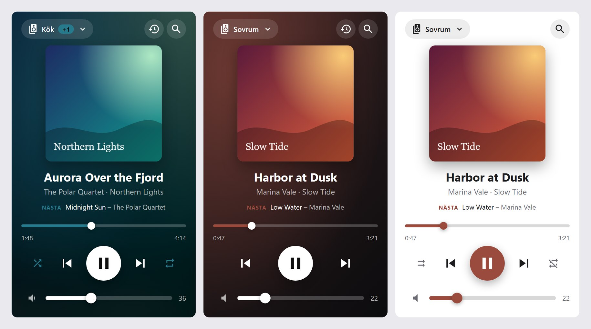
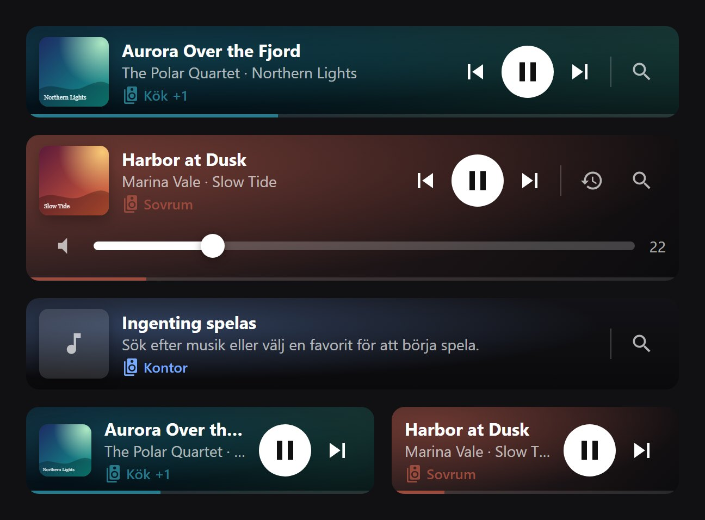
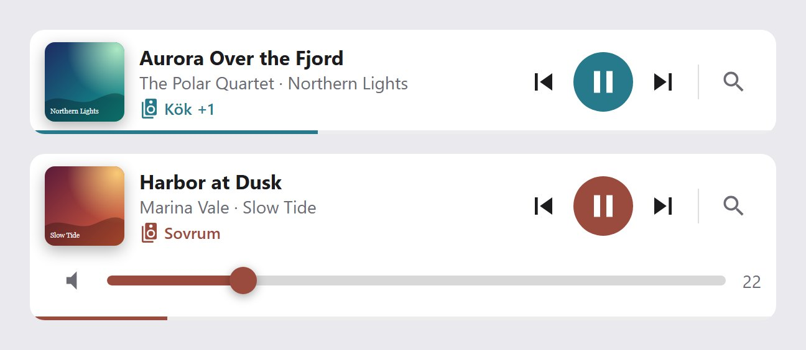
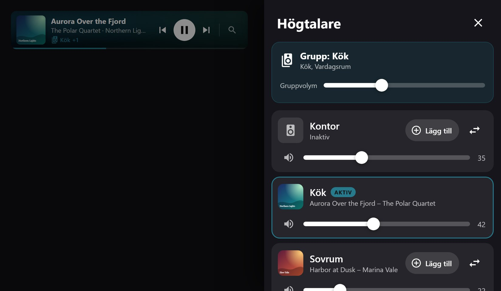

# MA Player Card

A [Music Assistant](https://music-assistant.io) player card for Home Assistant, in three sizes:

| Layout | Made for |
|---|---|
| **Fullscreen** (default) | Wall tablets running a kiosk dashboard – fills the whole screen |
| **Large** | A regular dashboard card with artwork, seek bar, all transport controls and volume |
| **Compact** | A single row: artwork, title, play/pause/next, speaker picker and search |


- Blurred artwork background and an accent color taken from the cover
- Transport, seek and volume controls (group volume when speakers are synced)
- Speaker drawer: pick the active player, add/remove speakers to the group, move the queue, per-room volume
- Search with instant library results and favorites; recently played
- Everything can be set up in the visual card editor – no YAML needed
- Swedish (default) and English UI

All communication goes through Home Assistant's Music Assistant integration – no direct connection to the MA server.

## Layouts

### Fullscreen

The original kiosk view. Put it in a view of type **panel** so it fills the screen. Search is pinned
to the top so the on-screen keyboard never covers it.


### Large

A dashboard card that fits in a sections or masonry view (default 6 of 12 columns). The speaker
name opens the speaker drawer; the buttons on the right open recently played and search. On narrow
cards the artwork moves above the title.



*Left to right: `background: artwork` (default), `background: accent` without shuffle/repeat, and
`background: theme` on a light theme.*

### Compact

One row that spans the full width by default. A thin line along the bottom shows the progress.
The volume slider and the recently played button can be turned on. On narrow cards the less
important buttons are hidden so the title keeps its room.



*Top to bottom: default, with volume and `background: accent`, nothing playing, and two narrow cards
(the right one with `show_artwork: false`).*

With `background: theme` the card follows the dashboard theme, light or dark:



### Popups

In the large and compact cards, search, recently played and the speaker drawer open over the
whole screen, with the same features as the fullscreen view.



## Installation

The card is installed from GitHub as a custom repository. Which steps you follow depends on your
Home Assistant version.

### Home Assistant Marketplace (Home Assistant 2026.11 and newer)

[](https://my.home-assistant.io/redirect/marketplace_repository/?owner=em0g&repository=ma-player-card&category=plugin)

Click the button above, or add it by hand:

1. **Settings** → **Marketplace** → **Add from link** (upper-right corner).
2. Enter `em0g/ma-player-card` and select **Add**. If asked for a type, choose **Dashboard**.
3. Select **MA Player Card** → **Install**, then reload the browser.

The Marketplace installs the card to `www/community/ma-player-card/` and adds the dashboard
resource for you. If you manage dashboard resources in YAML, add it yourself:

```yaml
lovelace:
  resources:
    - url: /local/community/ma-player-card/ma-player-card.js
      type: module
```

**Updating from HACS?** When Home Assistant 2026.11 starts for the first time, the Marketplace
takes over everything installed with HACS, including this card, and keeps it updated. Resources
defined in YAML that point to `/hacsfiles/ma-player-card/…` should be changed to
`/local/community/ma-player-card/…`; Home Assistant shows a repair for it.

### HACS (Home Assistant before 2026.11)

[](https://my.home-assistant.io/redirect/hacs_repository/?owner=em0g&repository=ma-player-card&category=plugin)

Click the button above, or add it by hand:

1. Open **HACS** → **⋮** (upper-right corner) → **Custom repositories**.
2. Repository: `https://github.com/em0g/ma-player-card`, type: **Dashboard** → **Add**.
3. Search for **MA Player Card** in HACS → **Download**, then reload the browser.

HACS adds the resource `/hacsfiles/ma-player-card/ma-player-card.js` for you. If you manage
resources in YAML, add it yourself with `type: module`.

When you later update Home Assistant to 2026.11 or newer, the card moves to the Marketplace by
itself – there's nothing to reinstall.

### Manual

Download `ma-player-card.js` from the [latest release](https://github.com/em0g/ma-player-card/releases/latest),
copy it to `/config/www/ma-player-card/` and add the resource `/local/ma-player-card/ma-player-card.js`
(JavaScript module). Manual installs don't get updates.

## Configuration

### Visual editor

Add the card from the dashboard's card picker (**+ Add card** → search for **MA Player Card**).
New cards start as a large card. In the editor you can choose:

- **Layout** – fullscreen, large card or compact card
- **Default player** and which **players** to show in the speaker drawer
- **Language** – Swedish or English
- **Show** (large and compact) – which parts of the card are visible, and the background
- **Advanced** – hiding unavailable players, the Music Assistant config entry, and for fullscreen the
  height and the free space at the bottom

The editor only writes options that differ from the defaults, so the YAML stays short.

### YAML examples

Fullscreen on a kiosk tablet:

```yaml
views:
  - title: Musik
    path: musik
    type: panel
    cards:
      - type: custom:ma-player-card
        default_player: media_player.vardagsrum
```

Large card:

```yaml
type: custom:ma-player-card
layout: large
default_player: media_player.kok
background: accent
show_shuffle_repeat: false
```

Compact card that follows the theme, with volume:

```yaml
type: custom:ma-player-card
layout: compact
default_player: media_player.sovrum
background: theme
show_volume: true
```

### Options

| Option | Default | Description |
|---|---|---|
| `layout` | `fullscreen` | `fullscreen`, `large` or `compact` |
| `default_player` | – | Player shown first on a device that hasn't picked one yet |
| `players` | all MA players | List of entity ids to show (in this order) |
| `hide_unavailable` | `true` | Hide unavailable players in the speaker list |
| `config_entry_id` | auto | Music Assistant config entry; set it if the dashboard user isn't an admin |
| `language` | `sv` | `sv` or `en` |
| `footer_space` | `0` | Fullscreen: pixels to keep free at the bottom (e.g. for navbar-card) |
| `height` | fills the screen below the card's top | Fullscreen: card height (CSS) |

Large and compact cards only. Defaults are listed as large / compact:

| Option | Default | Description |
|---|---|---|
| `show_artwork` | `true` / `true` | Cover image |
| `show_progress` | `true` / `true` | Seek bar (thin progress line in compact) |
| `show_volume` | `true` / `false` | Volume slider (group volume when synced) |
| `show_shuffle_repeat` | `true` / `false` | Shuffle and repeat buttons |
| `show_previous` | `true` / `true` | Previous track button |
| `show_next_up` | `true` / `false` | Next item in the queue (large only) |
| `show_player` | `true` / `true` | Speaker picker (opens the speaker drawer) |
| `show_search` | `true` / `true` | Search button |
| `show_recent` | `true` / `false` | Recently played button |
| `background` | `artwork` | `artwork` (blurred cover), `accent` (color from the cover) or `theme` (theme card color) |

The selected player is remembered per device (localStorage), so each tablet or phone can control its
own room.

<!-- ha-marketplace:exclude-start -->
## Development

```sh
npm install
cp .env.example .env.local   # set VITE_HA_URL and VITE_HA_TOKEN (long-lived token)
npm run dev                  # opens /dev/ – the card running against your real HA
                             # /dev/preview.html – all layouts with fake players, no HA needed
npm run build                # dist/ma-player-card.js
npm run deploy               # build + overwrite the installed file over SSH (HA_SSH, HA_WWW)
                             # and bump the resource ?v= so browsers reload it
```

The screenshots in `docs/` are taken from `/dev/preview.html?shot=<scene>` (scenes: `large`,
`large-variants`, `compact`, `compact-light`, `popup`), so they use made-up covers and players.

The `Validate` GitHub workflow runs the Marketplace (HACS) checks on every push.

Releases: bump the version in `package.json` and `VERSION` in `src/ma-player-card.ts`, run
`npm run build`, commit, then publish a GitHub release (tag `vX.Y.Z`) with
`dist/ma-player-card.js` attached. HACS and the Marketplace offer new releases to users; a tag alone
isn't enough.
<!-- ha-marketplace:exclude-end -->

## License

[MIT](LICENSE)
