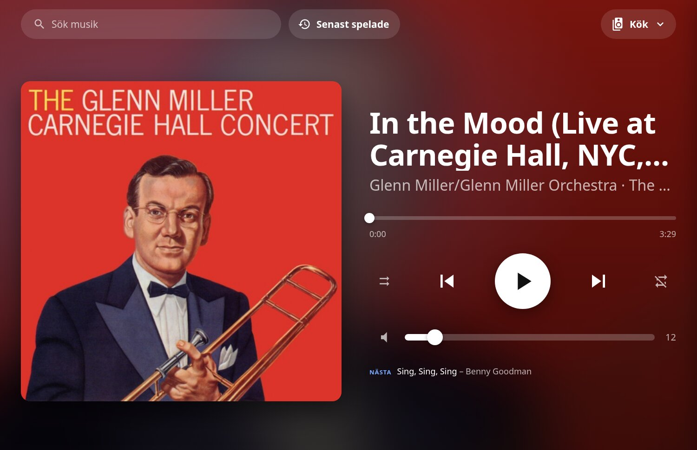
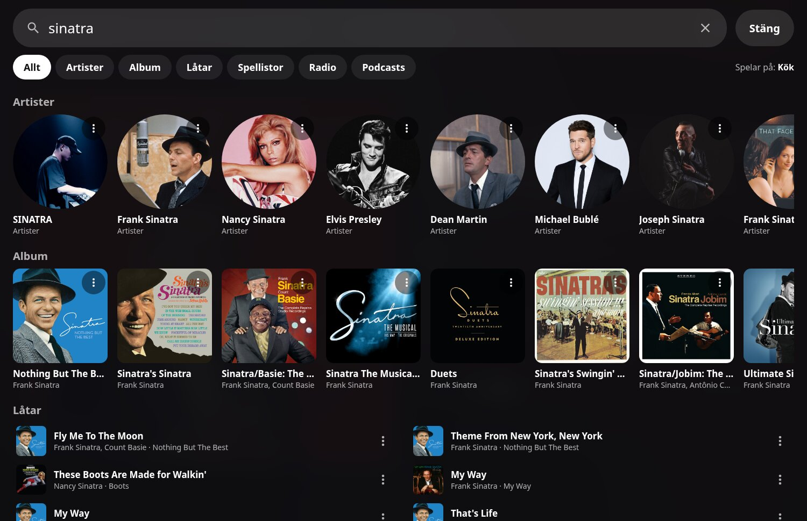

# MA Player Card

A [Music Assistant](https://music-assistant.io) player card for Home Assistant. Three layouts:

- **Fullscreen** (default) – built for wall tablets running a kiosk dashboard
- **Large** – a regular dashboard card with artwork, seek, all transport controls and volume
- **Compact** – a single row: artwork, title, play/pause/next, speaker picker and search

All options can be set in the visual card editor. In the large and compact cards, search,
recently played and the speaker drawer open as popups over the whole screen.

- Large now-playing view with blurred artwork background and accent color from the cover
- Big transport, seek and volume controls (group volume when speakers are synced)
- Speaker drawer: pick the active player, add/remove speakers to the group, move the queue, per-room volume
- Search pinned to the top of the screen so the on-screen keyboard never covers it; favorites when the field is empty
- Swedish (default) and English UI





All communication goes through Home Assistant's Music Assistant integration – no direct connection to the MA server.

## Installation

### HACS
1. HACS → ⋮ → **Custom repositories** → add `https://github.com/em0g/ma-player-card`, type **Dashboard**.
2. Install **MA Player Card** and reload the browser. HACS registers the resource
   `/hacsfiles/ma-player-card/ma-player-card.js` for you.

### Manual
Copy `dist/ma-player-card.js` to `/config/www/ma-player-card/` and add the resource
`/local/ma-player-card/ma-player-card.js` (JavaScript module).

## Usage

Put the card in a view of type **panel** so it fills the screen:

```yaml
views:
  - title: Musik
    path: musik
    type: panel
    cards:
      - type: custom:ma-player-card
        default_player: media_player.vardagsrum_2
```

| Option | Default | Description |
|---|---|---|
| `default_player` | – | Player shown first on a device that hasn't picked one yet |
| `players` | all MA players | List of entity ids to show (in this order) |
| `hide_unavailable` | `true` | Hide unavailable players in the speaker list |
| `config_entry_id` | auto | Music Assistant config entry; set it if the dashboard user isn't an admin |
| `language` | `sv` | `sv` or `en` |
| `footer_space` | `0` | Pixels to keep free at the bottom (e.g. for navbar-card) |
| `height` | fills the screen below the card's top | Card height (CSS, fullscreen only) |
| `layout` | `fullscreen` | `fullscreen`, `large` or `compact` |

Large and compact cards (defaults: large / compact):

| Option | Default | Description |
|---|---|---|
| `show_artwork` | `true` / `true` | Cover image |
| `show_progress` | `true` / `true` | Seek bar (thin progress line in compact) |
| `show_volume` | `true` / `false` | Volume slider (group volume when synced) |
| `show_shuffle_repeat` | `true` / `false` | Shuffle and repeat buttons |
| `show_previous` | `true` / `true` | Previous track button |
| `show_next_up` | `true` / `false` | Next item in the queue |
| `show_player` | `true` / `true` | Speaker picker (opens the speaker drawer) |
| `show_search` | `true` / `true` | Search button |
| `show_recent` | `true` / `false` | Recently played button |
| `background` | `artwork` | `artwork` (blurred cover), `accent` (color from the cover) or `theme` (theme card color) |

```yaml
type: custom:ma-player-card
layout: compact
default_player: media_player.kok
show_volume: true
background: theme
```

The selected player is remembered per device (localStorage).

## Development

```sh
npm install
cp .env.example .env.local   # set VITE_HA_URL and VITE_HA_TOKEN (long-lived token)
npm run dev                  # opens /dev/ – the card running against your real HA
                             # /dev/preview.html – all layouts with fake players, no HA needed
npm run build                # dist/ma-player-card.js
npm run deploy               # build + overwrite the HACS-installed file over SSH (HA_SSH, HA_WWW)
                             # and bump the resource ?v= so browsers reload it
```

## License

[MIT](LICENSE)
